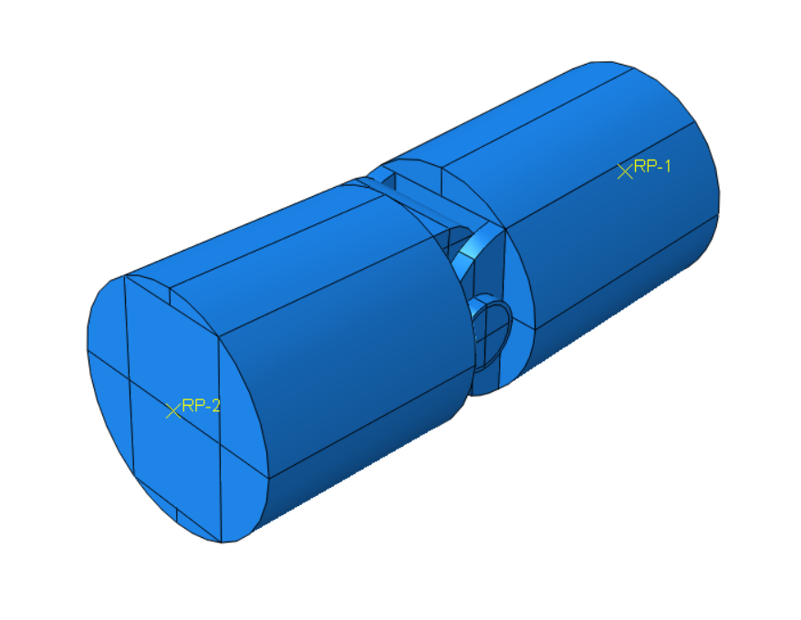
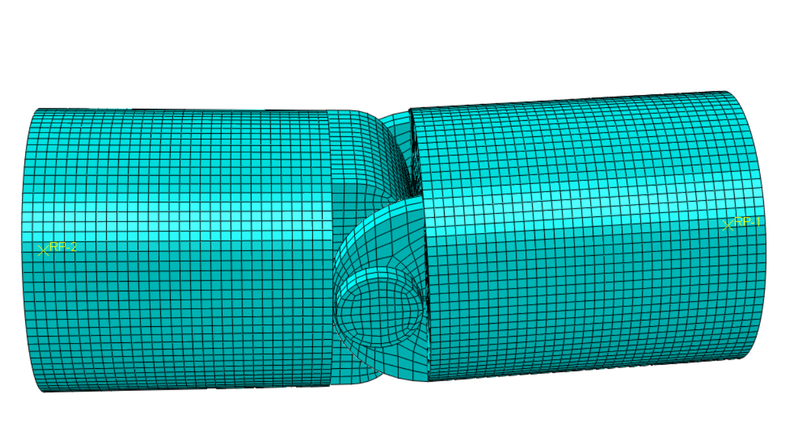
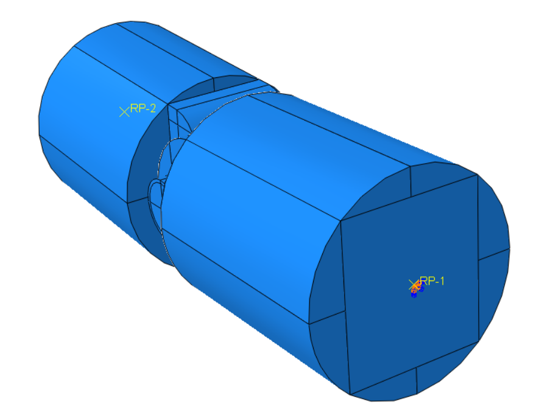
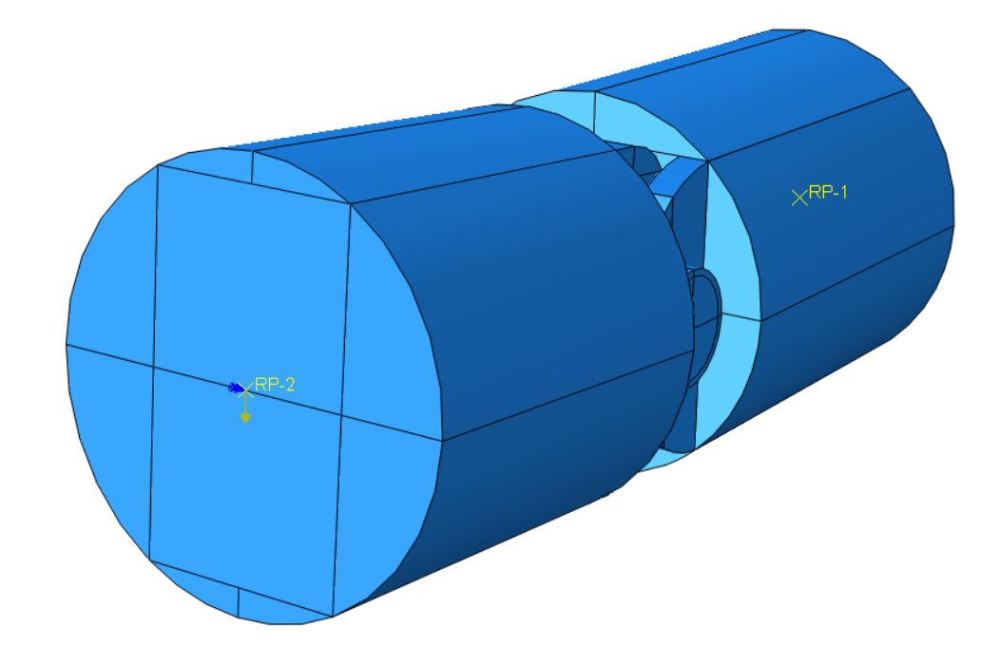
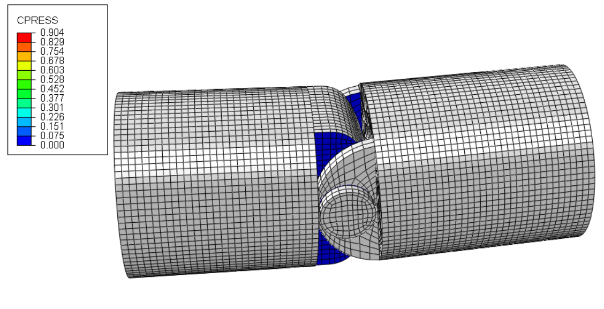
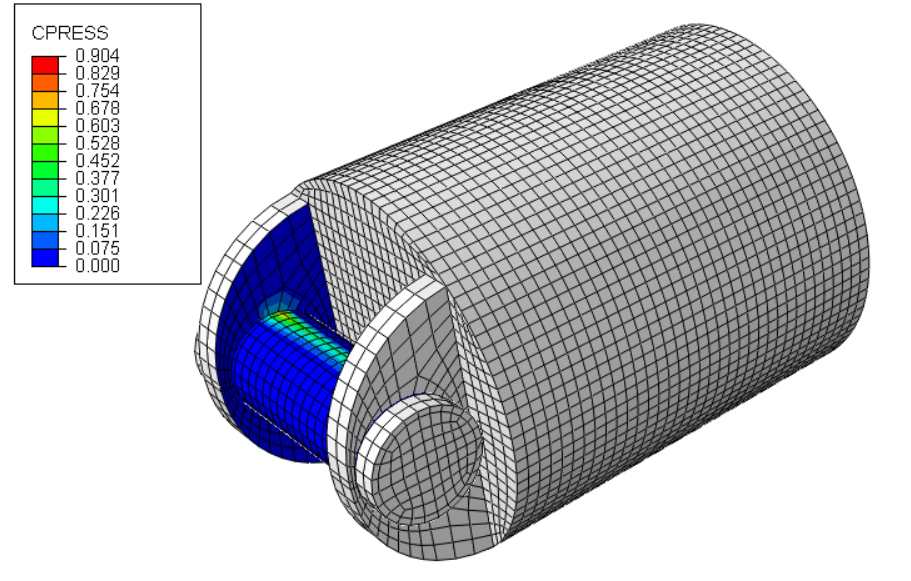
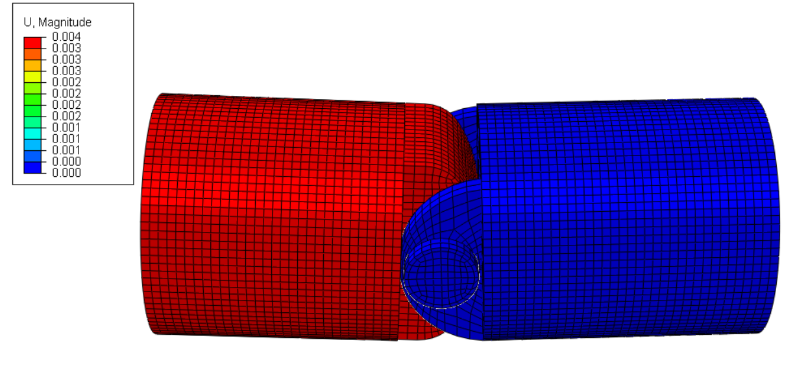

# Finger Joint Prosthesis (PIP): FEA of a Hinge Under a 10 N Load

Finite element analysis of a simplified hinge-type prosthesis for the proximal interphalangeal (PIP) finger joint, made in Abaqus/CAE. A 10 N force is applied to the moving part, and the model shows where the stress and the contact pressure appear in the hinge.

## Results at a glance

| Result | Value |
| :--- | ---: |
| Load | 10 N |
| Max von Mises stress | 0.66 MPa |
| Max contact pressure | 0.90 MPa |
| Max displacement | below 0.005 mm |

The peak stress is at the hinge, around the pin and the ears of the implant. It is very small compared with the strength of titanium alloy (several hundred MPa), so the hinge stays elastic under this load.

## About the model

- **Geometry:** the four parts were designed by a colleague in Abaqus. I did not model the geometry.
- **My part:** I built the whole analysis: partitioning and meshing, material, contacts and ties, supports, load and post-processing.
- **Tool:** Abaqus/CAE 6.14 (Standard solver).
- **Units:** mm, N, MPa.

### Parts

The part names in the input file are in Romanian. This table explains them.

| Name in the file | English | What it does |
| :--- | :--- | :--- |
| `implant_articular_deget` | finger joint implant | Fixed part. Its two ears hold the pin. |
| `parte distala` | distal part | Moving part. It sits on the pin, between the ears, and receives the load. |
| `bolt` | bolt | The hinge pin. |
| `piulita bolt` | bolt nut | Small nut at the end of the pin. |

## Model setup

### Material
All four parts use one isotropic, linear elastic titanium alloy.

| Property | Value |
| :--- | ---: |
| Material | Ti-6Al-4V |
| Young's modulus (E) | 110,000 MPa |
| Poisson's ratio | 0.33 |

### Mesh
Structured hexahedral elements (C3D8R), about 56,000 in total. The parts were partitioned by hand so they could be meshed this way. Global element size 1.0 mm, curvature control 0.05. Results come from a single mesh; no mesh convergence study was done.

### Connections between parts
- **Tied:** the pin is tied to the holes in the ears of the implant, so it stays fixed in the implant. The nut is tied to the pin and to the implant face.
- **Contact (two pairs):** the pin and the hole of the distal part, and the distal part and the faces of the ears. Both use hard contact with friction (coefficient 0.15). The distal part is free to rotate on the pin.

### Supports
The base of the implant is fixed in all directions (ENCASTRE). It is connected through a reference point (RP-1) to the round rear face of the implant.

### Load
- A force of **10 N** (in the -Y direction) at a reference point (RP-2), which is connected to the end face of the distal part.
- Rotation about the pin axis is locked at the same point, so the hinge stays at one fixed angle. This is a check of the hinge in one position, not a simulation of the finger bending.
- Single static step. The 10 N is a reference value to see where the load goes, not a measured pinch force.

### Names in the input file

| Name in the file | What it is |
| :--- | :--- |
| `Int-bolt-distal` | Contact: pin and distal part |
| `Int-distal-implant` | Contact: distal part and ears of the implant |
| `Tie-bolt` | Tie: pin and nut |
| `Tie-bolt-implant` | Tie: pin and implant |
| `Constraint-5` | Tie: nut and implant face |
| `Constraint-base` / `Constraint-tip` | Couplings that connect RP-1 and RP-2 to the round end faces |
| `Base-encastre` | Fixed support at RP-1 |
| `BC-3` / `Load-1` | Rotation lock and 10 N force at RP-2 |

## Results

### Von Mises stress
The maximum von Mises stress is **0.66 MPa**, in the hinge area around the pin and the ears of the implant.

The lighter stress patches at the outer ends of the parts come from the supports and the coupling on the round end faces. They are an effect of how the load is applied, not a result for the hinge, so the value to read is the stress at the hinge.

### Contact pressure
The maximum contact pressure is **0.90 MPa**. It forms a narrow strip along the pin, on the side where the load pushes. The faces of the ears are barely touched.

### Displacement
The maximum displacement is about 0.004 mm: the distal part moves as one block and the fixed implant does not move. This value is not used as a stiffness, because part of it comes from the small gaps between the parts closing at the start (see Limitations).

## Limitations

- One simple load case: 10 N at one fixed hinge angle. There is no bending motion and no tendon or muscle forces.
- The load is a reference value, so I do not give a safety factor.
- The material is linear elastic. Bone, wear and fatigue are not included, and the geometry is simplified.
- Results are from one mesh, with no convergence study.
- The parts touch each other with no clearance in the geometry. The mesh makes circles from small flat facets, which leaves gaps of a few microns. They close in the first part of the step, and this makes the displacement look larger than the real deformation.
- The results were not compared with physical measurements.

## Files

- [models/pinch-grip-2.inp](models/pinch-grip-2.inp): Abaqus input file
